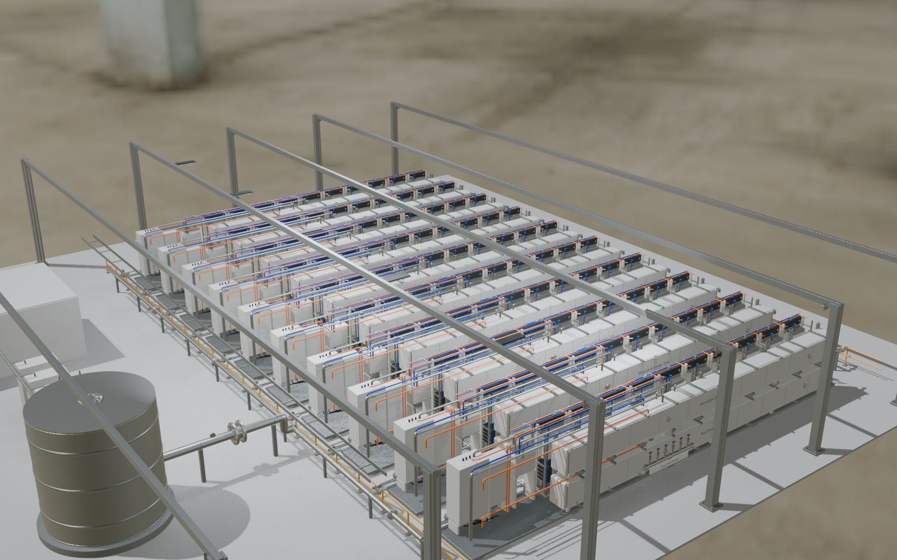

# TES industrial asset workflow

The viewer now loads evaluated Blender geometry instead of reconstructing the equipment from simplified boxes and cylinders.

## Editable assets

- `attachments/TES_Industrial_Unit.blend`: the original TES unit, with fabrication and connection detail added.
- `attachments/TES_Industrial_Facility_10_Rows.blend`: the ten-row facility, with ten ECR and fuel-cell hubs per TES row (100 facility hubs). Each row's upper electrolyte and lower fuel tank spans the complete 17.8 m ten-hub width, with ten-bay saddles and panel seams. The standalone TES unit keeps its four-hub layout.
- `attachments/TES_Reference_Model.blend`: preserved original source.

The native files contain packed steel/paint normal and roughness maps. The upgraded materials distinguish stainless steel, galvanized frames, coated steel, rubber seals, brass fittings, and bright fasteners. Added assemblies include hollow flange pairs, gasket seams, studs with washers and hex heads, isolation valves, dial gauges, pipe clamps, skid anchors, cabinet hinges/vents/glands, and protected conduit.

The original TES dimensions and major equipment arrangement are retained. Connection detail is a visual reference rather than a validated fabrication or process drawing.

## Previews and review





See [verification.md](verification.md) for the completed checks and browser rendering limitations.

## Regenerate

Use Blender 5.2 LTS with this repository as the working directory:

```sh
blender --background --python scripts/blender/upgrade_industrial.py
```

Add `-- --render` for the unit, facility overview, and production detail renders. Python with the `bpy` 5.2 module also runs the script directly. The build restarts Blender for final native scene cleanup after exporting the web geometry. Native files are written into `attachments/`; uncompressed exports are written into `public/`; temporary textures/renders are written into the ignored `artifacts/industrial/` directory.

Compress the web exports using glTF Transform 4.5.1:

```sh
npx --yes @gltf-transform/cli@4.5.1 meshopt public/tes-unit.glb artifacts/industrial/tes-unit-optimized.glb --quantize-position 16 --quantize-normal 12 --quantize-texcoord 16
npx --yes @gltf-transform/cli@4.5.1 meshopt public/facility.glb artifacts/industrial/facility-first-pass.glb --quantize-position 16 --quantize-normal 12 --quantize-texcoord 16
npx --yes @gltf-transform/cli@4.5.1 meshopt artifacts/industrial/facility-first-pass.glb artifacts/industrial/facility-quantized.glb --quantize-position 14 --quantize-normal 10 --quantize-texcoord 12
npx --yes @gltf-transform/cli@4.5.1 simplify artifacts/industrial/facility-quantized.glb artifacts/industrial/facility-simplified.glb --ratio 0.85 --error 0.002
npx --yes @gltf-transform/cli@4.5.1 meshopt artifacts/industrial/facility-simplified.glb artifacts/industrial/facility-pre-tangents.glb --quantize-position 14 --quantize-normal 10 --quantize-texcoord 12
node scripts/blender/strip_web_tangents.mjs artifacts/industrial/facility-pre-tangents.glb artifacts/industrial/facility-no-tangents.glb
npx --yes @gltf-transform/cli@4.5.1 meshopt artifacts/industrial/facility-no-tangents.glb artifacts/industrial/facility-optimized.glb --quantize-position 14 --quantize-normal 10 --quantize-texcoord 12
cp artifacts/industrial/tes-unit-optimized.glb public/tes-unit.glb
cp artifacts/industrial/facility-optimized.glb public/facility.glb
```

The viewer includes the Meshopt decoder. Exports retain selectable part metadata, smooth/hard normals, image maps, and UVs. Unit meshes retain stored tangents; the facility viewer derives tangent space for its normal maps. Unit meshes are evaluated and grouped by part/material; facility rows reference the same mesh data. UV coordinates intentionally repeat outside the unit square, so the compressor leaves those UVs at full precision. The facility is simplified within a 0.2% error threshold for its larger 100-hub scene.

## Verify

```sh
node --test scripts/blender/asset-contract.test.mjs
python scripts/blender/verify_storage_extent.py
npm run typecheck
npm run build
npx --yes @gltf-transform/cli@4.5.1 validate public/tes-unit.glb
npx --yes @gltf-transform/cli@4.5.1 validate public/facility.glb
```

The asset checks protect the original source, require embedded PBR maps and selection tags, and verify ten complete rows with shared mesh data. Browser QA must also inspect the unit/facility on desktop and mobile and exercise component selection, camera views, cutaway/closed/X-ray, flow highlighting, and scene switching.
